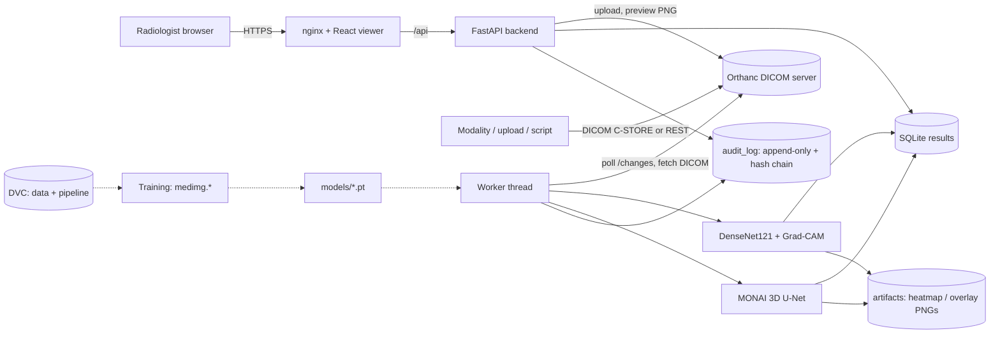

# Architecture

## Flow
1. A study arrives in Orthanc (C-STORE, `/instances`, or the viewer's Upload button, which wraps PNG/JPG as DICOM).
2. The worker polls `/changes` from a persisted cursor.
   - `NewInstance` with Modality DX/CR/DR: decode DICOM (rescale, window, MONOCHROME1 fix) -> classify -> Grad-CAM for the top class.
   - `StableSeries` with Modality CT and at least 20 slices: sort slices, build volume + RAS affine, save NIfTI, run 3D U-Net with sliding window, invert to the original grid, write per-slice overlays and organ volume.
3. Results are stored with model version, a demo flag and status `pending_review`; an `ai_result_created` audit entry is written.
4. The viewer fetches scan previews from Orthanc via the backend and overlays the heatmap/mask.
5. Approve/Reject is applied atomically (one decision per result) and audited.

## Audit log design
- SQLite triggers reject `UPDATE` and `DELETE` on `audit_log`.
- Each row stores `prev_hash` and `entry_hash = SHA-256(prev_hash + fields)`; `/api/audit` verifies the chain and reports the first broken row.
- Triggers stop accidents; the hash chain exposes someone who bypasses them with raw DB access. It does not stop deletion of the whole file, so back it up or ship entries to write-once storage in production.

## Design choices
- Polling instead of Orthanc Lua callbacks: simpler, restart-safe (cursor in DB), easy to test.
- Grad-CAM via `autograd.grad` on the last feature map: avoids hook problems with in-place ReLU in DenseNet.
- Train and serve share `medimg.config` and the same transforms to prevent preprocessing drift.
- Patient-level splits; thresholds chosen on validation only; test set touched once by `evaluate.py`.
